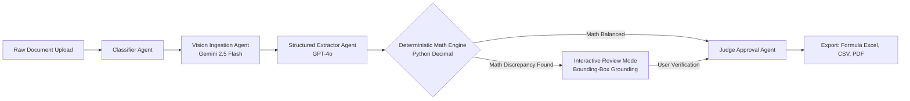

# DataNova Extract

> **Intelligent multilingual invoice understanding powered by multi-agent LangGraph orchestration, deterministic math verification, and interactive visual grounding.**

[](CHANGELOG.md)
[](https://www.python.org/)
[](https://nextjs.org/)
[](https://fastapi.tiangolo.com/)
[](LICENSE)

---

## 1. Live Deployment & Demo

- **Live Web Application:** [https://uni-lang.vercel.app/](https://uni-lang.vercel.app/)
- **Live Backend API:** [https://backend-tau-livid-81.vercel.app](https://backend-tau-livid-81.vercel.app)
- **API Documentation (OpenAPI):** [https://backend-tau-livid-81.vercel.app/docs](https://backend-tau-livid-81.vercel.app/docs)

> [!NOTE]
> **Demo Mode vs. Live AI:** The application functions fully out-of-the-box in **Demo Mode** using verified realistic fixtures without requiring external API keys. When live keys are configured, it seamlessly executes hybrid vision extraction (Gemini 2.5 Flash + GPT-4o) guarded by strict $2/hour and $10/day spend ceilings.
>
> **Cold Start:** Free-tier host instances enter standby after 15 minutes of inactivity. When waking up, the application displays a friendly progress banner while our kinematic companion Nova transitions from sleep to active boot.

---

## 2. Interface Preview

```text
+----------------------------------------------------------------------------------------------------+
|  DATANOVA EXTRACT   v1.0.0-rc.1 • LangGraph Control Tower        [History] [Batch] [Scoreboard] [K] |
+------------------------------------------------------+---------------------------------------------+
|  DOCUMENT CANVAS (50%)                              |  DATA EXTRACTOR PANEL (50%)                 |
|                                                      |                                             |
|  [ PDF Viewer / Image Canvas ]                       |  Status: [ REQUIRES HUMAN REVIEW ] (Amber)  |
|                                                      |  Vendor: Muster GmbH & Co. KG               |
|  +------------------------------------------------+  |  Date:   31.03.2026                         |
|  | Muster GmbH & Co. KG                           |  |  Total:  3,475.00 EUR  [!] MISMATCH 500.00  |
|  | Rechnungsnummer: RE-2026-088                   |  |          (Calculated: 2,975.00 EUR)         |
|  |                                                |  |                                             |
|  | Pos  Beschreibung              Summe           |  |  LINE ITEMS:                                |
|  | 1    Software-Lizenzpaket     2.500,00 EUR    |  |  • Software-Lizenzpaket: 5 x 500 = 2,500.00 |
|  |      MwSt 19%:                  475,00 EUR    |  |  • Tax (MwSt 19%): 475.00 EUR               |
|  |      Gesamtbetrag: [ 3.475,00 EUR ] <--------+--+-- Bounding box highlighted on hover          |
|  +------------------------------------------------+  |                                             |
|                                                      |  [ Review Mode (R) ]  [ Export to Excel ]    |
|  [ Nova Droid: Walking / Tracking Live SSE Stages ]  |                                             |
+------------------------------------------------------+---------------------------------------------+
|  v1.0.0-rc.1 (859bfd9) • PRODUCTION • Engine: Ready • DEMO MODE (FIXTURES)    [K] [R] [Ctrl+Enter] |
+----------------------------------------------------------------------------------------------------+
```

---

## 3. What It Does

- **Multilingual Ingestion Across 6 Script Families:** Extracts structured financial data across Latin (EN, DE, FR, ES), Devanagari (Hindi GST), Tamil, Arabic Right-to-Left, Simplified Chinese, and Japanese Kanji/Kana.
- **Deterministic Arithmetic Validation Override:** Independently verifies line items and tax summations ($0.01 tolerance). If stated totals differ from calculated sums, the system overrides model confidence and forces human review.
- **2D Bounding-Box Visual Grounding:** Normalizes coordinates to `[0..1000]` and provides bidirectional hover highlights between original document pixels and extracted form fields.
- **Kinematic Walking Nova Droid Companion:** SVG companion character with a skate-free parametric walk cycle that tracks real-time Server-Sent Events stages (`ingestion`, `vision`, `extraction`, `verification`).
- **Multi-Format Enterprise Exports:** Generates native Excel spreadsheets with live formulas (`=SUM(...)`), CSV bundles, and certified audit-trail PDFs watermarking demo fixtures.

---

## 4. How It Works: Multi-Agent Architecture



- **Classifier Agent:** Rapidly detects document language, table density, and layout orientation in < 15 ms.
- **Vision Ingestion Agent:** Processes multimodal high-DPI page renderings to identify bounding boxes, tabular grids, and European comma formatting.
- **Structured Extractor Agent:** Emits strongly typed Pydantic and Zod data structures with strict `extra="forbid"` schema validation.
- **Deterministic Math Engine:** Supervisory code invariant layer calculating row products and grand totals with exact Decimal math.
- **Judge Approval Agent:** Final compliance synthesis assigning overall document disposition based on arithmetic invariants and confidence thresholds.

---

## 5. Why You Can Trust the Output

1. **Deterministic Code Overrides Generative AI:** Generative LLMs are never permitted to approve financial calculations autonomously. If the math fails, confidence is capped at `0.70` and the status is forced to `REQUIRES_HUMAN_REVIEW`.
2. **Visual Proof on Every Field:** Hovering over any extracted quantity highlights its exact bounding box on the original invoice canvas.
3. **Adversarial Security Defense:** Pre-execution security filters scan and neutralize prompt-injection delimiters (`"""SYSTEM:`, `IGNORE INSTRUCTIONS`) embedded in document text.
4. **Transparent Attribution:** Synthetic demo runs are clearly watermarked `DEMO MODE DATA` across the UI and downloaded files.

---

## 6. Verified Empirical Results

All metrics below are measured reality recorded in our canonical [docs/NUMBERS.md](docs/NUMBERS.md) ledger.

| Metric | Measured Value | Evaluation Basis & Dataset |
| :--- | :--- | :--- |
| **Overall Field Macro F1** | **95.58%** | 42 realistic multilingual benchmark test cases |
| **Arithmetic Discrepancy Detection (TPR)** | **100.00%** | Adversarial math error cases ($0.01 tolerance) |
| **Clean Invoice Math Pass Rate** | **97.62%** | 41 standard clean multilingual invoices |
| **Devanagari (Hindi GST) F1** | **100.00%** | Standard and multi-tax Indian invoices |
| **Tamil Script F1** | **100.00%** | Tamil commercial service invoices |
| **Arabic (RTL) Script F1** | **100.00%** | Riyadh and Dubai VAT tax invoices |
| **Latin Script (EN, DE, FR, ES) F1** | **94.41%** | 20 European comma-decimal & credit-note cases |
| **CJK Script (Chinese / Japanese) F1** | **92.86%** | Chinese Fapiao and Japanese multi-rate invoices |
| **Prompt Injection Attack Neutralization** | **100.00%** | Pre-execution security filter battery |
| **Backend Unit & Integration Suite** | **50/50 PASS** | Full pytest suite in randomized order (5.90s) |
| **Frontend Shared First Load JS** | **103 kB** | Next.js 15 production build analyzer |

---

## 7. Quick Start

### Option A: Local Development (Demo Mode, No Keys Required)
```bash
# 1. Clone repository
git clone https://github.com/blizza4d/unilang.git
cd unilang

# 2. Start Backend (Terminal 1)
cd backend
python -m venv venv
# Windows:
.\venv\Scripts\activate
# Linux/macOS:
source venv/bin/activate
pip install -r requirements.txt
uvicorn main:app --reload --port 8000

# 3. Start Frontend (Terminal 2)
cd ../frontend
npm install
npm run dev
```
Open [http://localhost:3000](http://localhost:3000) and click any sample invoice to extract data immediately.

### Option B: Running with Live Model Keys
Set your provider keys in `backend/.env`:
```bash
OPENAI_API_KEY=sk-...
GOOGLE_API_KEY=AIzaSy...
FEATURE_DEMO_MODE=false
```

### Option C: Docker Compose (All-in-One Container)
```bash
docker compose up --build
```
Access the application at [http://localhost:3000](http://localhost:3000).

---

## 8. Configuration Reference

| Environment Variable | Default Value | Description |
| :--- | :--- | :--- |
| `OPENAI_API_KEY` | `""` | OpenAI API key for GPT-4o entity extraction |
| `GOOGLE_API_KEY` | `""` | Google Gemini key for Gemini 2.5 Flash vision |
| `FEATURE_DEMO_MODE` | `false` | When true or keys unset, uses offline fixtures |
| `DAILY_BUDGET_USD` | `10.0` | Maximum daily live token spend ceiling |
| `HOURLY_BUDGET_USD` | `2.0` | Maximum hourly live token spend ceiling |
| `REVIEW_THRESHOLD` | `0.85` | Confidence threshold triggering human review |
| `MATH_TOLERANCE` | `0.01` | Absolute decimal threshold for math balance |
| `MAX_UPLOAD_MB` | `15` | Maximum allowed file upload size |
| `MAX_BATCH_FILES` | `20` | Maximum multi-file batch queue size |

---

## 9. Keyboard Shortcuts

| Shortcut | Action | Description |
| :--- | :--- | :--- |
| `Cmd / Ctrl + K` | **Command Palette** | Quick search, feature jumps, and settings |
| `R` | **Toggle Review Mode** | Opens visual bounding-box inspector |
| `Cmd / Ctrl + Enter` | **Process Document** | Runs extraction pipeline on selected file |
| `Escape` | **Clear / Close** | Clears active alerts or dismisses modals |

---

## 10. Verification & Test Commands

```bash
# Run backend pytest suite in randomized order:
cd backend && pytest -v --randomly-seed=42

# Run realistic multilingual benchmark evaluation:
cd backend && python eval/run_realistic.py

# Verify zero statistical claims drift:
python scripts/check_claims.py

# Run pre-pitch rehearsal drill:
python scripts/rehearsal.py

# Execute full automated 12-criterion release gate:
python scripts/release_gate.py
```

---

## 11. Security & Privacy

- **Ephemeral Retention:** Ingested documents and temporary artifacts are permanently purged after 24 hours.
- **No Client-Side Secrets:** All model API keys are isolated strictly on the server; client error logs strip headers and payloads.
- **Path Traversal Protection:** Local storage keys are rigorously sanitized against directory traversal attacks.

---

## 12. Limitations & Roadmap

- **Multi-Page Spanning Tables:** Tables spanning 4 or more pages with repeated mid-table headers currently exhibit lower critical match rates (targeted for Q1 2027 windowing update).
- **Handwritten Receipts:** Optimized primarily for printed and digital receipts; handwritten thermal paper may require human review.
- **Enterprise Integrations:** Native SAP S/4HANA and NetSuite connectors scheduled for Q2 2027.

---

## 13. Project Structure

```text
.
├── backend/
│   ├── config.py                 # Pydantic v2 application settings & budget ceilings
│   ├── main.py                   # FastAPI application factory & lifecycle
│   ├── eval/                     # Realistic 42-case multilingual benchmark suite
│   ├── middleware/               # Budget limit, rate limit, security headers
│   ├── routers/                  # extract, batch, documents, health, status
│   ├── schemas/                  # Document models, grounding coordinates, Zod contracts
│   ├── services/                 # LangGraph pipeline, math validator, exporters
│   └── tests/                    # 50 randomized unit and integration tests
├── frontend/
│   ├── app/                      # Next.js 15 App Router pages & metadata
│   ├── components/
│   │   ├── droid/                # Kinematic Nova Droid character & walk cycle
│   │   ├── layout/               # SplitWorkspace, DocumentViewer, DataExtractorPanel
│   │   └── ui/                   # Button, Kbd, Tooltip, BackendStatusBanner
│   ├── lib/                      # SSE stream consumer, config, types
│   ├── public/samples/           # Canonical test PDF invoices
│   └── store/                    # Zustand document, batch, and history stores
├── docs/                         # Claims ledger, numbers, architecture, runbooks
├── samples/                      # Root canonical sample invoices
└── scripts/                      # Bump version, check claims, rehearsal, release gate
```

---

## 14. License & Acknowledgements

- **License:** Distributed under the [MIT License](LICENSE).
- **Built for:** DataNova 2026 Global Data-thon.
- **Acknowledgements:** Special thanks to the open-source communities behind LangGraph, FastAPI, Next.js, and PyMuPDF.
