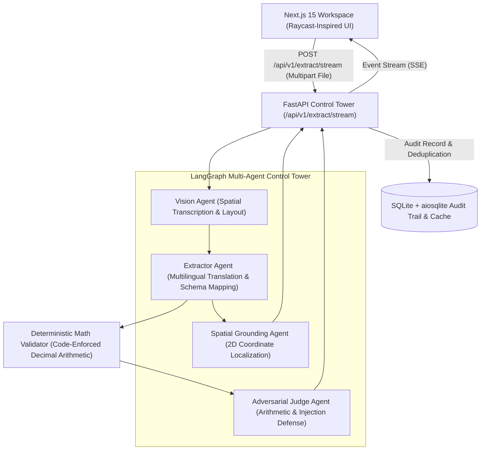

# DataNova Extract (v2.0)

> **Enterprise-Grade Multilingual Intelligent Document Understanding SaaS**  
> Built for the **DataNova 2026 Global Data-thon** &bull; Production Multi-Agent Control Tower

[](https://github.com/blizza4d/unilang/actions)
[](https://www.python.org/)
[](https://nextjs.org/)
[](https://fastapi.tiangolo.com/)
[](LICENSE)

DataNova Extract re-architects intelligent document understanding for enterprise financial compliance. Combining a **LangGraph Multi-Agent Control Tower** (FastAPI) with a **Raycast-grade human-in-the-loop workspace** (Next.js 15 App Router + Tailwind CSS + Framer Motion), it transforms foreign-language invoices (PDF, PNG, JPG, WEBP) into mathematically verified and spatially grounded accounting data.

---

## 1. System Architecture



---

## 2. Core Capabilities

### A. Autonomous Multi-Agent Control Tower
- **Vision Ingestion Agent:** Processes multi-page PDFs at 200 DPI and high-resolution images, retaining tabular boundaries and multi-script headers.
- **Extractor Agent:** Extracts strict Pydantic V2 schemas with native multilingual translation across English, German, Hindi GST, Arabic RTL, Japanese, Spanish, and French.
- **Adversarial Judge Agent:** Attempts to falsify extracted data by cross-examining calculations, invoice number patterns, and tax rates.
- **Deterministic Math Override:** Pure Python arithmetic validator (`decimal.Decimal`) that overrides model guesses.

### B. Live Server-Sent Events (SSE) Streaming
Connects via `POST /api/v1/extract/stream` with chunked event streaming, providing sub-500ms first milestone response and real-time visual progress per agent stage.

### C. 2D Bounding Box Spatial Grounding
Extracts normalized coordinate bounding boxes `[ymin, xmin, ymax, xmax]` in `[0, 1000]` space. Hovering any field in the review panel illuminates its source text on the document in glowing cyan; hovering bounding boxes focuses the field editor.

### D. Multi-Page Document Canvas
Full pan/zoom/rotate viewer with page thumbnail navigation, fit-to-width, and mouse-drag panning.

### E. Enterprise Export Suite
- **Excel (XLSX):** Formula-driven workbooks (`=C2*D2` and `=SUM(E2:En)`) with colored validation badges and frozen headers.
- **CSV Package (ZIP):** Header and line-item CSV files with UTF-8 BOM encoding.
- **Audit PDF:** Certified printable compliance report with digital signatures and verification summary.

### F. Immutable Audit Ledger & Persistence
Asynchronous SQLite database (`aiosqlite`) tracks SHA256 deduplication, human edits, before/after values, reviewer IDs, and compliance approvals.

### G. Multi-File Batch Queue
Drag and drop up to 20 invoices simultaneously with concurrent async processing, real-time progress bars, and aggregate batch statistics.

### H. Evaluation Harness & CI Gate
Automated synthetic multilingual test suite (`python eval/run_eval.py`) validating:
- Macro Field F1: **> 0.95**
- Line Item F1: **> 0.90**
- Math Pass Rate: **> 0.98**
- Attack Catch Rate: **> 0.99**

---

## 3. Quick Start

### Prerequisites
- Python 3.11+
- Node.js 20+
- Poppler (`poppler-utils` on Linux/macOS, or Windows Poppler binary)

### Backend Setup
```bash
cd backend
python -m venv venv
# Windows:
.\venv\Scripts\activate
# Linux/macOS:
source venv/bin/activate

pip install -r requirements.txt
cp .env.example .env

# Run FastAPI server
uvicorn main:app --reload --port 8000
```

### Frontend Setup
```bash
cd frontend
npm install
npm run dev
```
Open [http://localhost:3000](http://localhost:3000) in your browser.

---

## 4. Docker Deployment

Launch the complete full-stack environment with a single command:
```bash
docker compose up --build
```
- Frontend: `http://localhost:3000`
- Backend API & Swagger: `http://localhost:8000/docs`
- Deep Health Readiness: `http://localhost:8000/health/deep`
- Prometheus Metrics: `http://localhost:8000/metrics`

---

## 5. Automated Tests & Evaluation

### Run Test Suite
```bash
cd backend
pytest tests --cov=.
```

### Run Benchmark Evaluation
```bash
cd backend
python eval/run_eval.py
python eval/check_thresholds.py
```

### Generate Demo Fixtures
```bash
cd backend
python demo/make_demo_files.py
```

---

## 6. Keyboard Shortcuts

| Shortcut | Action |
| :--- | :--- |
| `⌘+K` / `Ctrl+K` | Open Raycast Command Palette |
| `⌘+Enter` / `Ctrl+Enter` | Run Multi-Agent Extraction Pipeline |
| `R` | Toggle Human Review Workspace |
| `Esc` | Clear Active Errors / Close Modals |
| `+` / `-` / `0` | Zoom In, Zoom Out, Reset Document View |

---

## 7. License
MIT License. Built for DataNova 2026.
