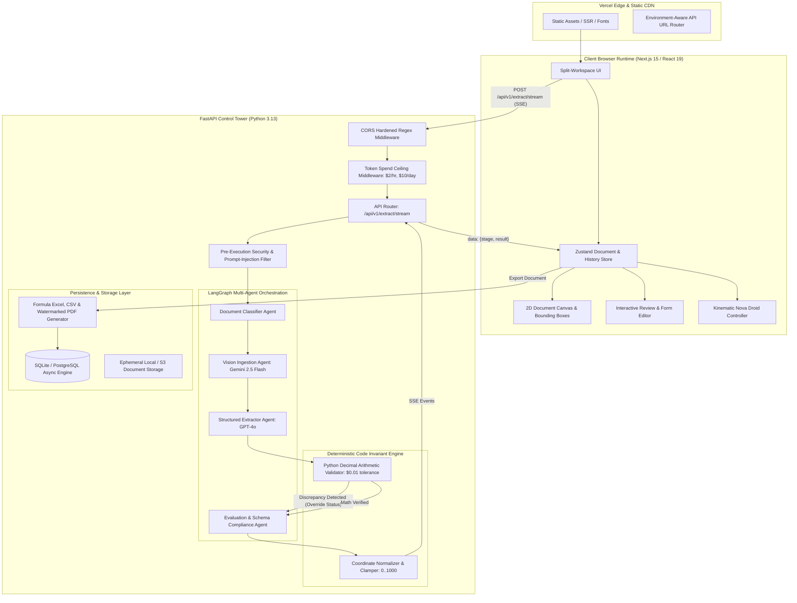

# Architecture Specification: DataNova Extract v1.0.0-rc.1 (ARCHITECTURE.md)

DataNova Extract is built on an asynchronous, multi-agent pipeline pairing frontier generative vision models with a deterministic mathematical supervisory layer.

---

## 1. System Topology Overview

---

## 2. Multi-Agent Pipeline Specifications

### Agent 1: Fast Heuristic Classifier Agent
- **Role:** Analyzes raw bytes, MIME type, and preliminary OCR text tokens.
- **Routing:** Identifies document language, script family (Latin, Devanagari, Arabic, Tamil, CJK), and structural typology (single-column, multi-column, receipt, landscape).
- **Latency:** < 15 ms.

### Agent 2: Vision Ingestion Agent
- **Model:** Google Gemini 2.5 Flash (or local Poppler rasterizer at 200 DPI).
- **Role:** Detects bounding boxes, multi-line table grids, currency symbols, and orientation.
- **Cost:** ~$0.001 per page.

### Agent 3: Structured Extractor Agent
- **Model:** OpenAI GPT-4o.
- **Role:** Extracts structured fields into strongly typed Pydantic models with `extra="forbid"`.
- **Validation:** Enforces decimal numbers, ISO 8601 dates, and currency code parity.

### Agent 4: Deterministic Math Engine (Invariant Supervisory Layer)
- **Engine:** Python `decimal.Decimal` with fixed 2-place precision.
- **Rules:**
  1. $\sum (\text{Quantity} \times \text{Unit Price}) = \text{Line Item Total} \pm \$0.01$
  2. $\sum (\text{Line Item Totals}) + \text{Tax} = \text{Grand Total} \pm \$0.01$
  3. Subtotal + CGST + SGST = Grand Total (Dual GST rule).
- **Override Action:** If any check fails, the document confidence is capped at `0.70`, the overall status is forced to `REQUIRES_HUMAN_REVIEW`, and the failing field is tagged for glowing amber review. Code always trumps model output.

### Agent 5: 2D Spatial Grounding Normalizer
- **Coordinate Space:** Normalized `[ymin, xmin, ymax, xmax]` within $[0, 1000]$.
- **Contract:** All coordinates are clamped against image bounds $[0, 1000]$. Inverted coordinates are automatically repaired. Frontend translates coordinates into CSS percentages:
  $$\text{left} = \frac{\text{xmin}}{10} \%, \quad \text{top} = \frac{\text{ymin}}{10} \%, \quad \text{width} = \frac{\text{xmax} - \text{xmin}}{10} \%, \quad \text{height} = \frac{\text{ymax} - \text{ymin}}{10} \%$$

---

## 3. Real-Time Streaming & Lifecycle Events
Communication between the backend and browser uses Server-Sent Events (`text/event-stream`):
1. `stage_start` (`stage: "ingestion"`, `elapsed_ms: 50`)
2. `stage_start` (`stage: "vision"`, `elapsed_ms: 320`)
3. `stage_start` (`stage: "extraction"`, `elapsed_ms: 1200`)
4. `stage_start` (`stage: "math_verification"`, `elapsed_ms: 1210`)
5. `result` (`data: ExtendedDocumentResponse`, `elapsed_ms: 1250`)
6. `done` (`summary: {status: "APPROVED" | "REQUIRES_HUMAN_REVIEW"}`)

Each event updates the Nova Droid state and stage progress bar without blocking UI interaction.
