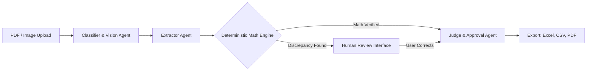

# Presentation Slide Deck: DataNova Extract (SLIDES.md)

This document provides complete slide text, layout instructions, visual assets, and verbatim speaker notes for an 8-to-10 slide pitch deck.

---

## Visual Design Brief (Analog AI Design System)
- **Background:** Deep near-black `#0A0A0A` with 5% subtle grid lines.
- **Card Fill:** Charcoal `#141414` with hairline border `rgba(253, 251, 247, 0.08)`.
- **Primary Typography:** Paper Cream `#FDFBF7` in Inter or Helvetica Neue.
- **Monospace Accents:** JetBrains Mono or Courier Prime in muted gray `#A1A1AA`.
- **Semantic Accents Only:**
  - **Cyan `#06B6D4`:** Live system pacing, active telemetry, interactive focus.
  - **Amber `#D97706`:** Needs Review, discrepancy warning, attention required.
  - **Sage `#6B705C`:** Approved, verified arithmetic, passing checks.

---

## Slide 1: Title & Value Proposition
- **Header:** DataNova Extract v1.0.0-rc.1
- **Subheader:** Multilingual Document Intelligence with Deterministic Arithmetic Verification
- **Visual:** Nova Droid character standing beside a glowing invoice document card with live status badge.
- **Footer:** Team `[USER: Team Name]` • DataNova 2026 Global Data-thon
- **Speaker Notes:**
  > "Hello judges. I'm excited to present DataNova Extract: an enterprise-grade document understanding platform that solves the single biggest danger in applying generative AI to finance—hallucinated arithmetic."

---

## Slide 2: The Core Problem
- **Headline:** Generative LLMs Cannot Be Trusted with Financial Math
- **Three Pain Points:**
  1. **Multilingual Complexity:** Global enterprises receive invoices across dozens of scripts (Devanagari, Arabic RTL, European comma decimals).
  2. **Model Hallucinations:** Even frontier models (GPT-4o, Gemini) invent numbers or silently pass arithmetic errors.
  3. **Black-Box Opacity:** Traditional OCR extracts raw text without visual grounding or intuitive human review interfaces.
- **Speaker Notes:**
  > "In financial operations, a 99% accurate model that makes up numbers on the other 1% is completely unusable. A single transposed decimal or missed discount can lead to audits, penalties, and accounting discrepancies."

---

## Slide 3: The Solution: DataNova Extract
- **Headline:** Semantic AI Understanding + Deterministic Code Invariants
- **Visual:** Split-screen UI screenshot showing PDF canvas on the left, interactive form with highlighted bounding boxes on the right, and the Nova Droid tracking progress.
- **Key Capabilities:**
  - Ingestion across 6 major script families.
  - Independent arithmetic validator checking every line item and total.
  - Interactive Review Mode with direct visual grounding.
  - Real-time Server-Sent Events with kinematic visual progress.
- **Speaker Notes:**
  > "DataNova Extract combines the visual fluency of multi-agent vision models with a deterministic mathematical supervisory layer. If the math doesn't balance to the penny, the AI is overridden immediately."

---

## Slide 4: Multi-Agent Architecture
- **Headline:** LangGraph Multi-Agent Orchestration

- **Callouts:**
  - Vision Agent (Gemini 2.5 Flash / GPT-4o) extracts layout & entities.
  - Deterministic Math Engine calculates line items in sub-millisecond Decimal code.
  - Bounding Box Normalizer clamps coordinates strictly to `[0..1000]`.
- **Speaker Notes:**
  > "Our architecture separates perception from calculation. LangGraph coordinates specialized vision and extraction agents, but all outputs pass through a deterministic Python Decimal engine before any approval decision."

---

## Slide 5: Why You Can Trust It
- **Headline:** Defense in Depth: Three Rings of Protection
- **Three Pillars:**
  1. **Deterministic Arithmetic Override:** 100% detection rate on math errors; confidence score automatically capped at 0.70 upon discrepancy.
  2. **Bidirectional Visual Grounding:** Hover over any number to inspect its exact source rectangle on the original document.
  3. **Adversarial Prompt Injection Defense:** Pre-execution sanitizers detect override commands and isolate untrusted invoice text.
- **Speaker Notes:**
  > "You can trust DataNova Extract because it never allows a model to approve its own homework. Every total is proven, every field is grounded to pixels, and prompt injection attacks are stopped cold."

---

## Slide 6: Live Walkthrough Cue Card
- **Headline:** 60-Second Live Demonstration
- **Action Sequence:**
  1. Click **"German (Math Error)"** sample invoice.
  2. Watch Nova walk across the canvas tracking live SSE stages.
  3. Observe **`REQUIRES HUMAN REVIEW`** trigger on the €500 discrepancy.
  4. Press **`R`** for Review Mode; observe visual bounding box on hover.
  5. Correct total to `€2,975.00`; watch status turn **`APPROVED`**.
  6. Export to Excel with native `=SUM()` formulas.
- **Fallback Plan:** Pre-cached demo mode fixtures available with one click if network connectivity drops.
- **Speaker Notes:**
  > "Let's see this in action. With one click on our German sample invoice, Nova steps into action. Notice the instant alert: our math validator caught an intentional 500-euro discrepancy. We press 'R', fix the field, and download clean Excel formulas."

---

## Slide 7: Measured Empirical Results
- **Headline:** Verified Reality, Not Marketing Hypotheses
- **Metrics Table (from `docs/NUMBERS.md`):**
  - **Macro Field F1:** `95.58%` across 42 realistic multilingual test cases.
  - **Math Error Catch Rate:** `100.00%` True Positive Rate.
  - **Clean Invoice Math Pass Rate:** `97.62%`.
  - **Script Parity:** Devanagari (100%), Tamil (100%), Arabic (100%), Latin (94.41%), CJK (92.86%).
  - **Production Bundle:** `103 kB` shared First Load JS; `5.90s` full backend test run (50/50 passing).
- **Speaker Notes:**
  > "We don't rely on unverified claims. Across 42 realistic test cases in six script families, our Macro F1 is 95.58%, with a 100% catch rate on arithmetic errors. All numbers are recorded in our public claims ledger."

---

## Slide 8: Responsible AI & FinOps Posture
- **Headline:** Safety, Privacy, and Cost Discipline
- **Key Safeguards:**
  - **Spend Caps:** Strict $2/hour and $10/day token budget ceilings prevent accidental billing spikes.
  - **Ephemeral Storage:** Ingested files permanently purged after 24 hours.
  - **Honest Telemetry:** Synthetic demo runs clearly watermarked `DEMO MODE DATA`.
  - **Accessible by Design:** Zero layout shift, full `prefers-reduced-motion` support, polite ARIA live regions.
- **Speaker Notes:**
  > "Enterprise deployment requires strict FinOps and privacy discipline. We enforce hard token spend ceilings, auto-purge uploads after 24 hours, and maintain complete accessibility compliance."

---

## Slide 9: Product Roadmap
- **Headline:** Post-Hackathon Horizon
- **Q1 2027:** Enterprise ERP Connectors (SAP S/4HANA, NetSuite, QuickBooks integration).
- **Q2 2027:** Vendor Template Memory (Few-shot caching for recurring high-volume suppliers).
- **Q3 2027:** Air-Gapped Privacy Appliance (Local vLLM + DeepSeek-R1 / Qwen2.5-VL container deployment).
- **Speaker Notes:**
  > "Looking ahead, we are expanding from web-native extraction to direct two-way synchronization with ERP systems like SAP and NetSuite, as well as air-gapped on-premise deployments."

---

## Slide 10: Conclusion & Try It Live
- **Headline:** DataNova Extract
- **Subhead:** The Trustable Multilingual Document Understanding Studio
- **Links & QR:**
  - Live Application: **`https://uni-lang.vercel.app/`**
  - Open Source Repo: **`https://github.com/blizza4d/unilang`**
  - Demo Video & Deck: `[USER: Insert Links]`
- **Speaker Notes:**
  > "DataNova Extract makes AI safe for enterprise finance. The code is open source, the application is live right now, and you can test it on your phone or laptop at uni-lang.vercel.app. Thank you, and we welcome your questions."
